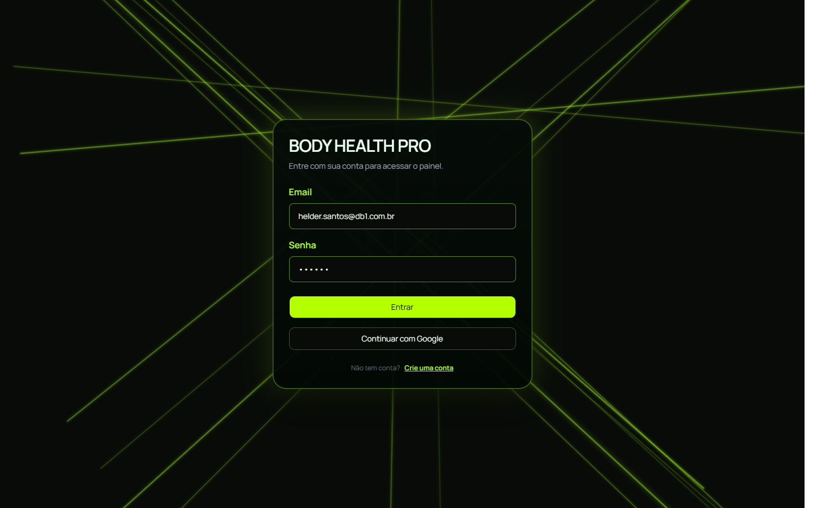
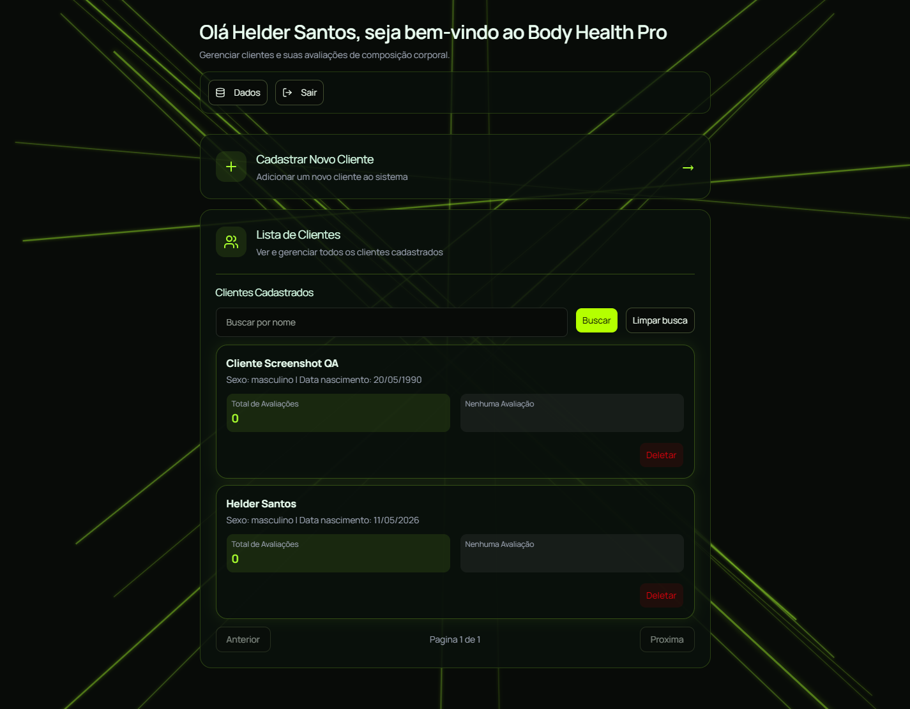
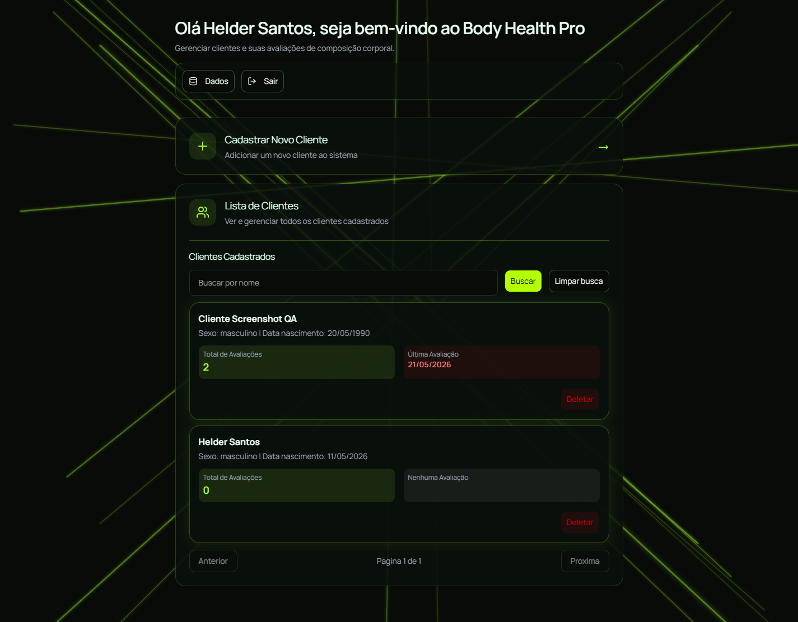
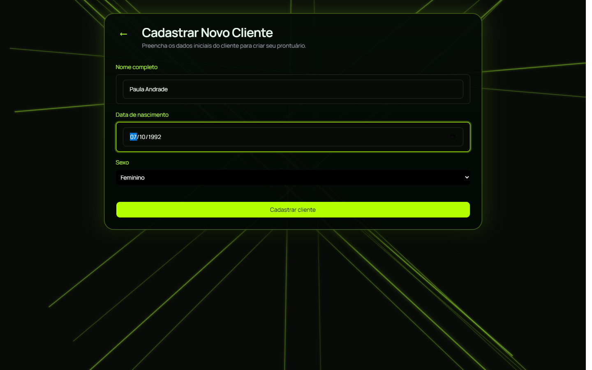
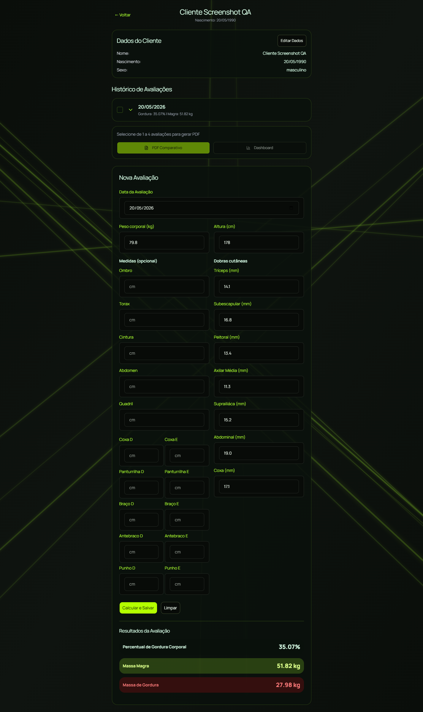
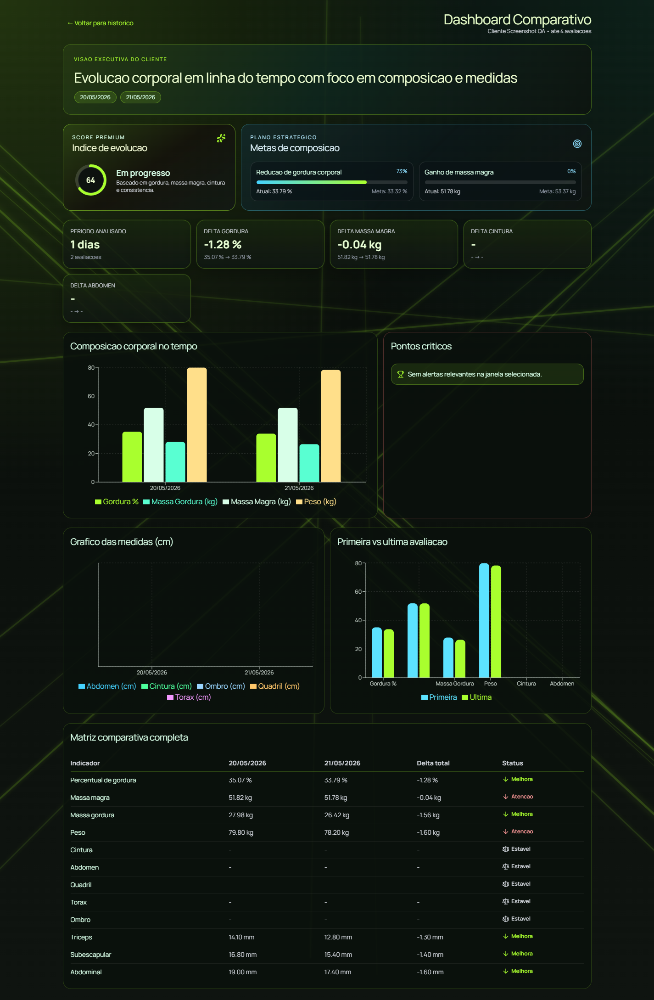

# Body Health Pro

Sistema de avaliação corporal desenvolvido para profissionais de Educação Física, permitindo acompanhar a evolução dos alunos através de avaliações antropométricas, dashboards comparativos e relatórios automatizados.

* Em produção

* Utilizado em ambiente real por profissional de Educação Física

* Autenticação e segurança com Supabase + Row Level Security (RLS)

* Dashboards evolutivos

* Relatórios em PDF

---

## Sobre o Projeto

O Body Health Pro nasceu a partir de uma necessidade real de uma profissional de Educação Física que precisava centralizar avaliações corporais, acompanhar a evolução dos alunos e reduzir a dependência de planilhas e cálculos manuais.

A plataforma foi desenvolvida para transformar esse processo em uma experiência digital completa, permitindo o gerenciamento de clientes, avaliações corporais, acompanhamento evolutivo e geração de relatórios.

---

## Problema

Profissionais de Educação Física frequentemente utilizam planilhas, calculadoras e processos manuais para registrar avaliações corporais e acompanhar a evolução dos alunos.

Esse processo pode gerar:

* Retrabalho
* Dificuldade de acompanhamento histórico
* Inconsistências nos dados
* Baixa produtividade
* Falta de visualização da evolução corporal

---

## Solução

O Body Health Pro centraliza todas as informações em uma única plataforma.

A aplicação permite:

* Cadastro de clientes
* Registro de avaliações corporais
* Cálculo automático de composição corporal
* Comparação entre avaliações
* Visualização da evolução física
* Geração de relatórios em PDF
* Controle de acesso por perfil

---

## Caso de Uso Real

O projeto foi criado para resolver uma necessidade real de uma profissional de Educação Física.

Atualmente a plataforma é utilizada para registrar avaliações corporais, acompanhar a evolução dos alunos e gerar relatórios comparativos de forma digital.

Esse projeto não foi criado como exercício ou tutorial, mas como uma solução aplicada a um cenário real de negócio.

---

## Principais Funcionalidades

### Autenticação

* Login seguro
* Controle de acesso por perfil
* Integração com Supabase Auth

### Gestão de Clientes

* Cadastro de clientes
* Consulta e atualização de informações
* Histórico de avaliações

### Avaliações Corporais

* Registro de medidas antropométricas
* Percentual de gordura
* Massa magra
* Massa gorda
* Indicadores físicos

### Dashboard Comparativo

* Comparação entre avaliações
* Evolução corporal
* Visualização gráfica

### Relatórios

* Geração de PDF
* Relatórios individuais
* Relatórios comparativos

---

## Tecnologias

### Frontend

* React
* TypeScript
* Vite
* React Router

### Validação

* Zod

### Backend & Banco de Dados

* Supabase
* PostgreSQL

### Gráficos e Relatórios

* Chart.js
* jsPDF

### Infraestrutura

* Vercel

---

## Arquitetura

O projeto utiliza uma arquitetura baseada em monorepo para compartilhamento de domínio, componentes e validações entre múltiplas aplicações.

```text
body-health-pro/
├── apps/
│   ├── admin/
│   │   └── Dashboard para profissionais
│   │
│   ├── client/
│   │   └── Área do cliente
│   │
│   └── site/
│       └── Landing page institucional
│
├── packages/
│   ├── core/
│   │   └── Regras de negócio
│   │
│   ├── auth/
│   │   └── Autenticação
│   │
│   ├── validation/
│   │   └── Schemas Zod
│   │
│   ├── database/
│   │   └── Tipos e scripts SQL
│   │
│   └── ui/
│       └── Componentes compartilhados
│
└── package.json
```

---

## Destaques Técnicos

* Monorepo com compartilhamento de domínio
* TypeScript em toda a aplicação
* Componentes reutilizáveis
* Schemas centralizados com Zod
* Autenticação via Supabase
* PostgreSQL
* Row Level Security (RLS)
* Multi-tenant
* Dashboards comparativos
* Geração dinâmica de PDF
* Lazy Loading
* Dynamic Imports
* Otimização de bundles
* Deploy automatizado via Vercel

---

## Segurança

A aplicação utiliza:

* Supabase Authentication
* PostgreSQL
* Row Level Security (RLS)
* Controle de acesso baseado em perfis
* Isolamento de dados por tenant

---

## Capturas de Tela (Playwright MCP)

As imagens abaixo foram geradas com viewport 1440x900 e full page, com tratamento visual para esconder toasts temporarios e aguardar fim de loaders.

### Login



### Dashboard Admin com tabela de clientes



### Home apos 2 avaliacoes (cards atualizados)

Evidencia visual do cliente com indicadores atualizados nos cards/lista:

- Total de Avaliacoes: 2
- Ultima Avaliacao: 21/05/2026



### Cadastro de cliente



### Avaliacao do cliente



### Dashboard comparativo



## Status do Projeto

### Concluído

* [x] Autenticação
* [x] Gestão de clientes
* [x] Avaliações corporais
* [x] Dashboard comparativo
* [x] Relatórios PDF
* [x] Deploy em produção
* [x] Multi-tenant
* [x] RLS

### Próximas Evoluções

* [ ] Aplicativo Mobile
* [ ] Dashboard analítico avançado
* [ ] Integração com dispositivos wearables
* [ ] Exportação avançada de relatórios
* [ ] Inteligência Artificial para análise de evolução corporal

---

## Métricas do Projeto

* 3 aplicações independentes
* 5 pacotes compartilhados
* Deploy em produção
* Multiusuário
* Controle de acesso por perfil
* Banco de dados PostgreSQL
* Arquitetura monorepo

---

## Aprendizados

Durante o desenvolvimento do Body Health Pro foram explorados conceitos relacionados a:

* Arquitetura Frontend
* Monorepo
* TypeScript avançado
* Design de domínio
* Controle de acesso
* Multi-tenancy
* Segurança com RLS
* Integração com Supabase
* Geração dinâmica de relatórios
* Otimização de performance

---

## Deploy

Admin:
https://body-health-pro-admin.vercel.app

---

## Licença

Projeto desenvolvido para fins educacionais e profissionais.